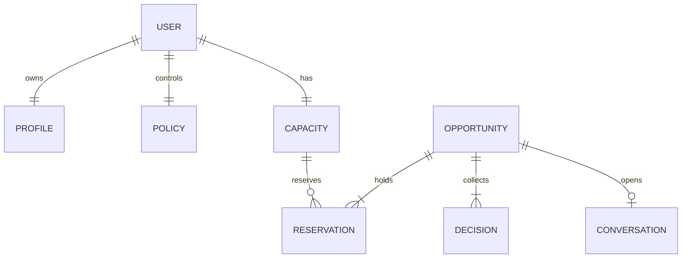
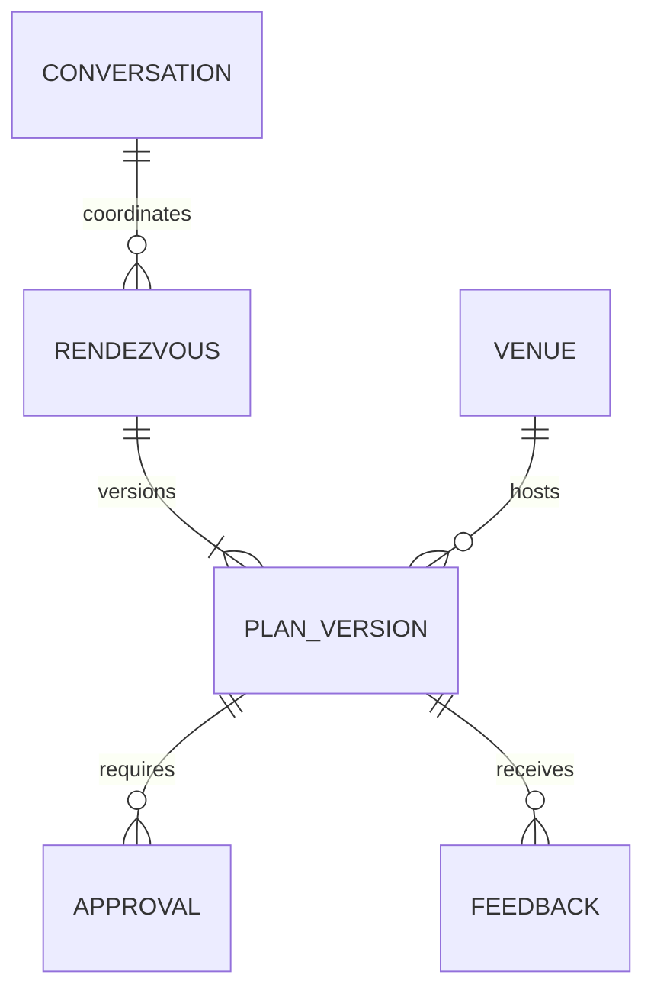
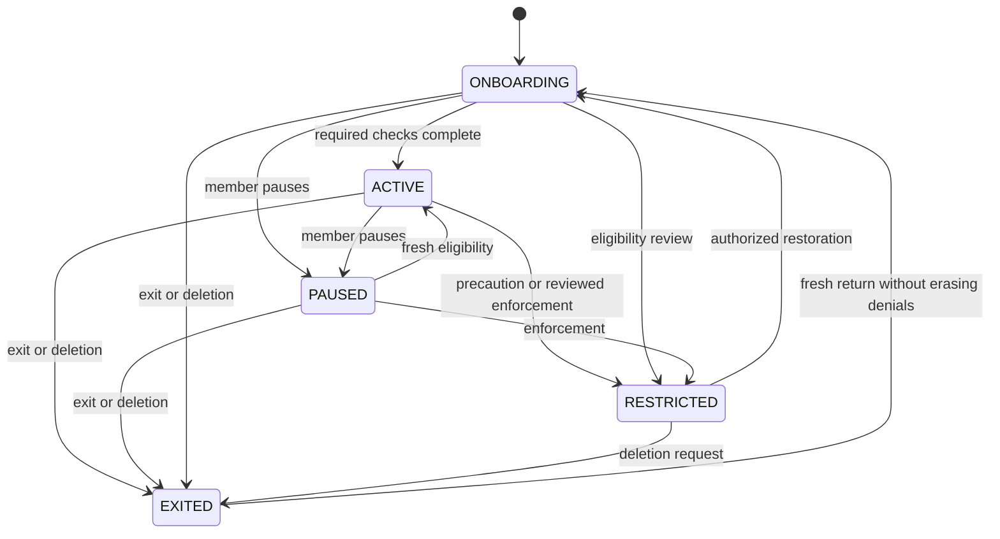
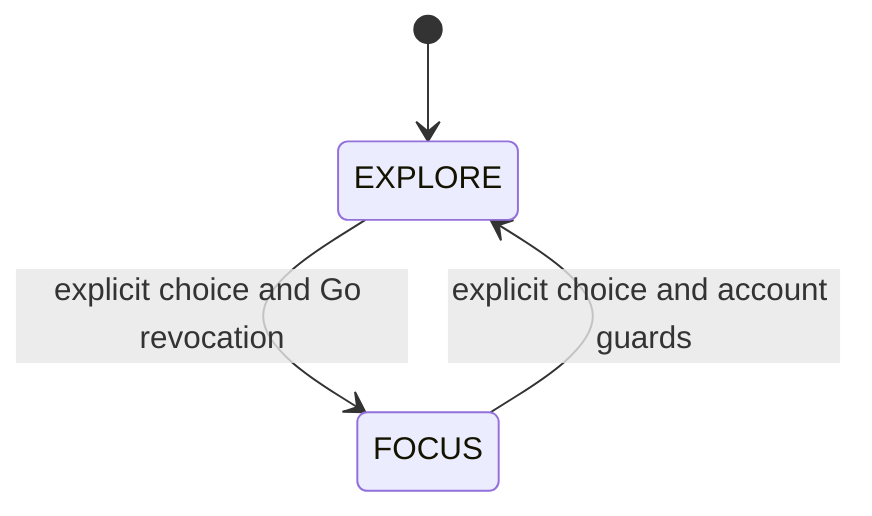
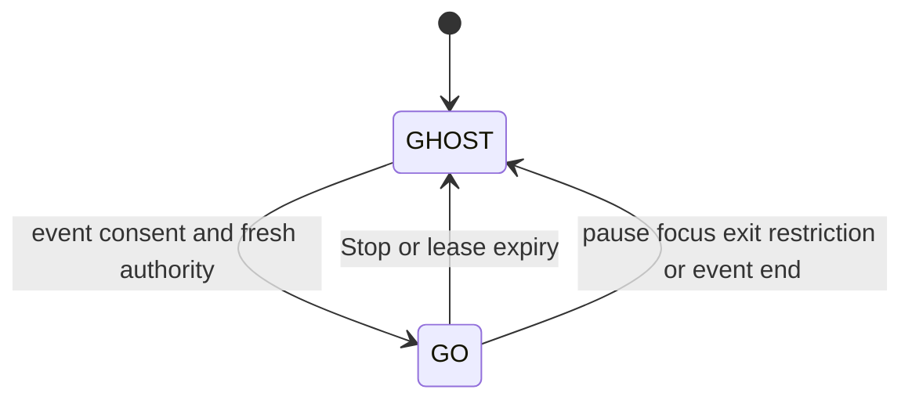
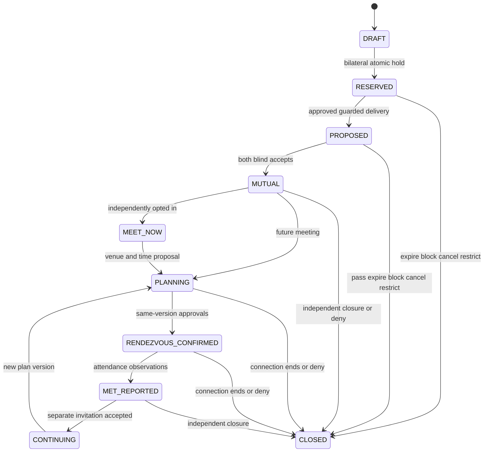
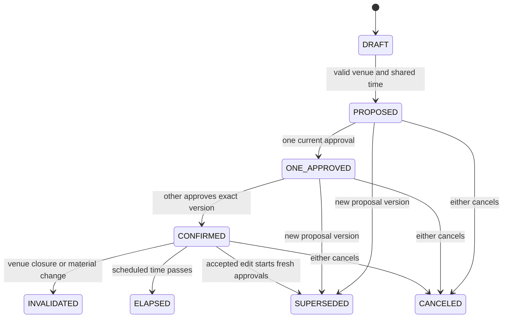

# Meetwell architecture — implementation and full plan

Status: M0 infrastructure and M1 accounts/onboarding are implemented. The current
slice below distinguishes them from the full planned entity/route model that follows.
Source: the authoritative v0.2 PDF, Spec P4–P6, P11–P13, P15–P23, P26, P29 and
P31. See DECISIONS.md for improvements and SPEC_TRACE.md for executable evidence.

Meetwell is a working name. The pilot catchment is Manhattan, New York City, ages 18–30 inclusive, using America/New_York time. Eight provisional areas are in `packages/config/src/pilot.ts`. These are broad public reference centroids for estimated travel, not inferred or collected member coordinates. No sign-up, profile, matching, chat, safety case UI, operator console or event feature ships in M0.

## Implemented M1 slice

M0 and M1 are implemented; the original entity/route designs below remain
**planned** except for this section. The authoritative source is the PDF.
M1 permits synthetic loopback development only. See DEC-024–028.

Migration 0002 adds identity users, consents, magic links, sessions, passkeys,
challenges and rate limits; app members, encrypted profiles, immutable preference
versions, media and command receipts; ops staff, audit and moderation receipts.
Migration 0003 adds narrow owner-media locking without general app UPDATE access.
Migration 0004 adds authentication delivery retry scheduling; per-message
transactions isolate failures. See DEC-030 and operations/auth-delivery.md.
Migrations are the executable field/key/index schema.

The [2026-10-20 gap analysis](architecture/review-2026-10-20.md) separates observed
M1 behavior from proposals and remaining release gates. The
[roadmap](product/roadmap.md) follows CODEX_PROMPTS numbering and order (DEC-033).
The founder rejected the crosswalk and approved deletion/operations before real use.

The web process uses separate identity/app/ops LOGIN pools with no administrator
fallback. Identity owns encrypted email/DOB and hashed tokens. App owns the single
account-state/version/epoch authority and encrypted profiles/preferences. Media is
decoded, metadata-stripped and envelope encrypted in a private bucket. Separate
keys protect identity, app and media. Production KMS/process isolation is a release gate.

Core owns date/cohort rules, strict schemas, bilateral hard preferences and state
transitions. Repositories use Drizzle reads and SQL transactions for locking/CAS.
The worker schedules `auth.deliver`; its generic mail comes from an encrypted,
retriable identity outbox. No product queue payload holds addresses or location.
The shared Node-only mail adapter currently lives in web/server; extract an adapter
package when more consumers justify it.

| Current route, prefixed by `/api/v1`                                                  | Authorization                                                                            |
| ------------------------------------------------------------------------------------- | ---------------------------------------------------------------------------------------- |
| `GET /health`                                                                         | Fixed anonymous liveness                                                                 |
| `POST /auth/request`, `/auth/consume`                                                 | Exact origin, generic response, keyed budgets, browser-bound one-time link               |
| `POST /auth/passkey/options`, `/auth/passkey/verify`                                  | RP/origin/challenge/user verification; registration requires a recent registered session |
| `GET /me`                                                                             | Own minimized age/policy/profile/preferences/photo/role DTO; no email or DOB             |
| `POST /account/register`                                                              | Own account, adult cohort and current consent versions                                   |
| `POST /auth/signout`; `GET /account/sessions`; `POST /account/sessions/revoke-others` | Own sessions                                                                             |
| `POST /account/policy`                                                                | Own versioned command/receipt; DELETE requires recent authentication                     |
| `POST /profile`, `/preferences`                                                       | Registered owner, strict field allowlists, CAS/receipt; disabled accounts denied         |
| `POST /photos`; `GET /photos/:id`; `POST /photos/:id/remove`                          | Registered owner, bounded bytes, object ownership and idempotent mutations               |
| `GET /ops/photos`, `/ops/photos/:id`                                                  | Operator/admin, pending media only, audited                                              |
| `POST /ops/photos/:id`                                                                | Recent operator/admin session, no self-review, version/CAS/receipt and audit             |
| `GET /ops/audit`                                                                      | Admin, audited read                                                                      |

Except health, account routes fail closed without local/test mode and loopback
APP_ORIGIN. Same-origin writes, HttpOnly SameSite cookies, no-store responses and
opaque errors apply. The server binds to loopback. Public/member/ops UI is responsive.

Readiness is checked under member/media locks. Removing a photo revokes active
discovery before storage deletion. Deletion first commits account disable; authority
rechecks this even if session revocation fails. M1 does not promise full erasure.
M5 must reconcile crash-orphaned encrypted media, perform retention and prove restore.

## Repository and boundaries

| Path              | Responsibility                                                                         | Forbidden dependency or responsibility                                                    |
| ----------------- | -------------------------------------------------------------------------------------- | ----------------------------------------------------------------------------------------- |
| `apps/web/app`    | Next.js App Router; public pages, member UI, `/ops`, versioned `/api/v1` transport     | No domain rules in components; no direct client database access                           |
| `apps/worker`     | Node/pg-boss; batch, outbox, expiry, retention/deletion schedules as milestones arrive | No policy decisions independent of core; no narratives or locations in job payloads       |
| `packages/core`   | Pure state transitions, bilateral gates, allocation, venue selection, policy checks    | No I/O, framework, environment, clock, randomness or database dependency; explicit inputs |
| `packages/db`     | Drizzle repositories, raw SQL locking/CAS, forward migrations, role-specific pools     | No business rule absent from core; no SQLite/fake database substitution                   |
| `packages/config` | Versioned pilot hypotheses, launch facts and default-off flags                         | No secrets; no per-user values or inferred traits                                         |
| `scripts`         | Local setup, migration entry point, bounded development grants                         | Never production credentials or automatic destructive database resets                     |
| `tests`           | Vitest/fast-check unit, real Postgres/PostGIS integration, Playwright end-to-end       | No skipped database tests that turn missing infrastructure into a pass                    |

The web process authenticates and validates transport, loads authorized projections via repositories, calls pure core functions and persists the returned transition under the locking protocol. Rendering consumes DTO allowlists. Core returns structured internal reasons; transport maps these to non-revealing member messages. Operator actions use the same core gates with an independently logged operator policy.

M0 registers only `GET /api/v1/health`, an anonymous liveness route returning fixed process status. It reveals no DB address, version, user, readiness detail or secret. The worker registers only `system.healthcheck`, a real durable infrastructure job. No future product job is represented by an empty handler.

## Database schemas and roles

PostgreSQL 16 with PostGIS. A dedicated migration administrator owns application schemas and objects. Runtime groups are NOLOGIN, NOSUPERUSER, NOCREATEDB, NOCREATEROLE, NOREPLICATION, NOBYPASSRLS, and have no cross-role membership. Deployment creates distinct LOGIN credentials with only the required group membership; the development administrator never becomes an application credential.

| Schema     | Runtime group       | Access contract                                                                                                                      |
| ---------- | ------------------- | ------------------------------------------------------------------------------------------------------------------------------------ |
| `identity` | `meetwell_identity` | Credential/session/age/consent service only; narrow projections/functions serve age and authority, never raw birth dates to profiles |
| `app`      | `meetwell_app`      | Explicit member-authorized product repositories; no safety narratives or identity secrets                                            |
| `safety`   | `meetwell_safety`   | Case-assigned safety service; narrative/evidence keys separate; every read audited                                                   |
| `learning` | `meetwell_learning` | Allowlisted pseudonymous selection/experience/logistics exports only; no location, chat, report text or demographic joins            |
| `ops`      | `meetwell_ops`      | Minimized operations, audit metadata and approved aggregate views; no implicit case privilege                                        |
| `queue`    | `meetwell_worker`   | pg-boss infrastructure only; runtime may create its queue tables, not application tables                                             |

M0 grants schema USAGE, not broad future table access. Each later migration grants exact tables, columns or narrow functions. Default PUBLIC function execution is revoked in sensitive schemas. Serving reads an authoritative `app.enforcement_status` projection containing deny/restriction state and version only. Safety writes that projection in the same transaction as an enforcement transition. It never returns case IDs, report count, reporter or narrative through the serving API. Blocks live in the restricted policy boundary with a narrow deny operation; policy locks serialize enforcement and discovery. Private report storage is not available through a general-purpose admin dashboard.

Migration/bootstrap and database-superuser capabilities necessarily exceed runtime roles. Their credentials are absent from deployed web/worker processes and require separate operational audit. Integration tests deliberately use an isolated test administrator to install extensions, then `SET LOCAL ROLE` to prove denial by runtime roles. Schema ownership is not granted to those runtime groups.

Worker jobs use separate purpose-scoped repository connections for authorized operations. A pg-boss credential alone cannot read identity, profile, learning or case stores. Job payloads contain opaque IDs/version guards only. The future safety worker uses a distinct deployment identity, never a universal queue payload with a case narrative.

## Planned entity model

Conventions: public identifiers are random UUIDs; internal references do not grant access. Sensitive ciphertext fields carry key version and authenticated context. Consequential aggregates have `version bigint`, timestamps and idempotency receipts. `member_id` refers to a stable opaque account identifier; no email-based join crosses schemas. All dates use timestamptz; timezone is explicit for local schedules. Every FK requires an explicit deletion policy; cascade is limited to purely owned non-held rows. Closure and enforcement records use purpose-limited tombstones instead of accidental cascading disclosure.

`PK` is the primary key, `UQ` a unique constraint, and `IX` a required index. Every in-scope Spec P22 entity is represented below; aliases are named explicitly.

### Identity, profile, preferences and policy

| Entity / schema                                 | Fields and keys                                                                                                                                                   | Constraints / indexes                                                                                    |
| ----------------------------------------------- | ----------------------------------------------------------------------------------------------------------------------------------------------------------------- | -------------------------------------------------------------------------------------------------------- |
| User / identity.users                           | PK member_id; encrypted email, email lookup token, encrypted birth_date, adult_status, account_state, eligibility_version, consent_version, deletion_requested_at | UQ email token; IX account state; birth_date never projected to app                                      |
| IdentityCheck / identity.checks                 | PK id; FK member_id; check_type, provider_ref, status, evidence_expiry, reviewed_by, version                                                                      | IX member/status; no raw ID/photo/biometric templates                                                    |
| ConsentRecord / identity.consents               | PK id; FK member_id; purpose, document_version, granted_at, revoked_at, scope                                                                                     | IX member/purpose/time; history immutable; no blanket discovery consent                                  |
| AuthSession / identity.sessions                 | PK random id; FK member_id; hashed token, device label, expiry, revoked_at, assurance_time                                                                        | UQ token hash; IX member/revocation and expiry; raw tokens never stored                                  |
| MagicLink / identity.magic_links                | PK id; lookup token hash, member/email handle, expiry, consumed_at, purpose                                                                                       | UQ hash; atomically consume once; generic response prevents account enumeration                          |
| Passkey / identity.passkeys                     | PK credential_id; FK member_id; public_key, counter, transports, created_at                                                                                       | UQ credential ID; no private key; reauthentication for enrollment/removal                                |
| Profile / app.profiles                          | PK member_id; chosen_name, approved age projection, intention, structure, interests, prompt, area_id, travel_limit, transport, moderation_status, version         | FK public area; IX discovery eligibility; explicit share scopes; immutable offer snapshot                |
| Media / app.media                               | PK id; FK member_id; private object key, MIME, dimensions, moderation_state, approved_version, metadata_stripped_at                                               | IX member/moderation; original upload private; no EXIF or executable content                             |
| ExplicitConstraint / app.constraints            | PK id; FK member_id; attribute, stated_value, setting, consent_scope, source=USER, prior_version, version, active                                                 | UQ member/attribute/current version; append history; hard UNKNOWN fails unless user explicitly allows it |
| SoftPreference / app.preferences                | PK id; FK member_id; attribute, stated_value, strength, flexibility, visibility, source, version                                                                  | IX member/attribute/version; strong/flexible distinction; never overwrite a statement                    |
| Availability / app.availability                 | PK id; FK member_id; weekday/window/timezone, effective dates, flexible flag, version                                                                             | IX member/time; DST-safe expansion over configured horizon                                               |
| DiscoveryPolicy / app.policies                  | PK member_id; account projection, intent, nearby, policy_epoch, mode_version, pause_chat_choice, lower_cap, version                                               | IX current eligibility; stale epoch/version denial; account remains authoritative in identity            |
| CapacityLedger / app.capacity                   | PK member_id; reserved_count, active_count, personal_cap, version                                                                                                 | CHECK nonnegative, sum <= personal cap; counters reconciled to reservations                              |
| ExposureLedger / app.exposure_budget            | PK member_id + period_start; delivered_count, pending_reserved_count, version                                                                                     | UQ member/week; check configured limit atomically; local-week boundary resolved server-side              |
| Reservation / app.reservations                  | PK id; FK opportunity_id/member_id; state, lease_until, released_at, release_reason, version                                                                      | UQ opportunity/member; partial IX live member/lease; release CAS exactly once                            |
| Enforcement projection / app.enforcement_status | PK member or pair key; deny_scope, active, enforcement_version, expires_at                                                                                        | No case narrative or reporter identity; authoritative deny checked under policy lock                     |

### Opportunities, presence and coordination

| Entity / schema                             | Fields and keys                                                                                                        | Constraints / indexes                                                                             |
| ------------------------------------------- | ---------------------------------------------------------------------------------------------------------------------- | ------------------------------------------------------------------------------------------------- |
| GeospatialZone / app.public_areas           | PK id; public label, static centroid/polygon, catchment, reviewed_at                                                   | GiST geography; public reference data only, no member fixes                                       |
| LocationSession / app.event_sessions        | PK opaque session ID; FK member,event; hashed token, consent_version, epoch, lease, max_expiry, renewal_count, version | Alias for event discovery authority; no GPS/cell/accuracy fields; partial UQ active member        |
| CurrentPresence / app.event_authority       | PK session_id; checked_in, last_authorized_at, lease_until                                                             | Event proof only; overwritten rather than appended; stale lease denies immediately before cleanup |
| CandidatePool / app.candidate_pools         | PK id; source, scope, policy_version, created_at, expires_at                                                           | IX scope/expiry; ephemeral materialization only when needed                                       |
| PoolMembership / app.pool_memberships       | PK pool_id/member_id; eligibility_version, expiry                                                                      | IX member; pool expiry deletes rows; RSVP alone insufficient                                      |
| CandidatePair / app.pair_keys               | PK canonical hash/ordered pair; low_member, high_member, terminal_reason, closed_at                                    | UQ low/high; CHECK low<high; no repeat across Explore/events/Go                                   |
| Opportunity / app.opportunities             | PK id; FK pair_id; type, mode, state, version, policy epochs, lease, feature_version, creation_policy                  | Partial UQ live pair; IX state/lease; terminal pair key remains after ordinary payload purge      |
| Recommendation / app.recommendations        | PK id; FK opportunity/batch; snapshot IDs, intended delivery, operator approval, policy_version                        | UQ opportunity/recipient; IX approved/deliverable; review edits invalidate prior eligibility      |
| Decision / app.decisions                    | PK opportunity/member; choice, version, decided_at, idempotency_key                                                    | UQ principal/action/key; counterpart DTO redacts until mutual; timeout is separate                |
| SelectionPropensity / learning.propensities | PK exposure_id; feature/policy versions, source, feasible_set_id, size, seed, step, q, operator flag                   | UQ batch/step/chosen edge; q nullable only for unknown operator policy; no location features      |
| Conversation / app.conversations            | PK id; FK opportunity; participant refs, state, closed_at, archive_suggested_at, version                               | UQ opportunity; IX each participant; no read receipts or typing records                           |
| Message / app.messages                      | PK id; FK conversation/sender; encrypted text, created_at, idempotency_key                                             | IX conversation/created_at; UQ sender/key; no content analytics                                   |
| MeetNowIntent / app.meet_now_intents        | PK id; FK connection/member/session; scope, consent_version, expiry, version                                           | UQ live connection/member; reuse connection capacity; no new unilateral disclosure                |
| Rendezvous / app.rendezvous                 | PK id; FK connection; current_plan_version, state, version                                                             | One current coordinating aggregate per meeting attempt                                            |
| DatePlan / app.plan_versions                | PK rendezvous_id/version; FK venue/review_version; start_at, timezone, activity, cost/access confirmations             | Immutable versions; venue changes cannot mutate an approved version                               |
| PlanApproval / app.plan_approvals           | PK rendezvous/version/member; approved_at, policy_epoch, idempotency_key                                               | Bilateral exact-version approvals; CHECK participant membership in transaction                    |
| Attendance / app.attendance                 | PK plan/member/source; status, reported_at, provenance, dispute_ref                                                    | IX plan; host event check-in never directly marks a pair meeting                                  |

### Venues, events, outcomes and operations

| Entity / schema                             | Fields and keys                                                                                                                                                                | Constraints / indexes                                                                     |
| ------------------------------------------- | ------------------------------------------------------------------------------------------------------------------------------------------------------------------------------ | ----------------------------------------------------------------------------------------- |
| PublicVenue / app.venues                    | PK id; public address/entrance/geography, timezone/hours, accessibility, cost, activity, alcohol_primary, alcohol_free, no_purchase, transit, emergency exits, active, version | GiST public geometry; IX active/review expiry; under-21 exclusion filter                  |
| VenueReview / ops.venue_reviews             | PK id; FK venue; reviewer, checked_at, expires_at, approval, partner contact/training, complaint references                                                                    | IX venue/latest; no public case narrative; stale review fails suggestions                 |
| Event / app.events                          | PK id; FK venue/organizer; time/window, scope, status, consent_version, conduct_review, version                                                                                | IX venue/time/status; cancel/reschedule invalidates scoped authority                      |
| EventConsent / app.event_consents           | PK event/member/purpose/version; RSVP or dating purpose, granted_at, revoked_at                                                                                                | Dating purpose distinct from RSVP; explicit renewal on scope change                       |
| EventCheckIn / app.event_checkins           | PK event/member; rotating code version/hash, host_confirmed_at, host_id                                                                                                        | UQ event/member; IX expiry; organizers see operational fields only                        |
| MatchingFeedback / app.feedback             | PK plan/member/version; met, again, optional bounded chips, consent_scope, created_at                                                                                          | Only author reads own response; no mutual-Yes reveal or automatic invitation              |
| BehaviorSignal / learning.selection_events  | PK event_id; pseudonymous actor/pair, exposure/decision, observation status, source version, event_time                                                                        | Append-only until lawful deletion; UQ source event; no dwell/chat/raw location            |
| ExperienceObservation / learning.experience | PK source/version; categorical met/again and missingness, observed_at, deletion subject handles                                                                                | No reason narratives; IX observation time; no inferred negative from silence              |
| LogisticsObservation / learning.logistics   | PK source/version; planning-stage and attendance provenance, duration buckets                                                                                                  | No venue ID, precise time/location or route; only allowed derived stage measures          |
| ReliabilityEvent / app.reliability_events   | PK id; member/pair, provenance, contextual status, disputed_at                                                                                                                 | No public score/penalty; separate from romantic feedback                                  |
| IntegritySignal / safety.integrity_signals  | PK id; reporter/subject, encrypted voluntary discrepancy, state, version                                                                                                       | Restricted review route; not automatically a proven lie                                   |
| ReviewOutcome / safety.review_outcomes      | PK id; case_ref, finding, reviewer, rationale_ciphertext, appeal_ref, created_at                                                                                               | Append-only review history; no user-visible moral label                                   |
| SafetySignal / safety.signals               | PK id; case/subject, type, source, minimally scoped evidence ref                                                                                                               | Case-only access; no ranking export                                                       |
| Report / safety.reports                     | PK id; reporter, subject tombstone ref, context, encrypted optional detail, severity, status, closed_at, hold_id                                                               | IX assigned queue/severity; cannot require block or completed feedback                    |
| Block / safety.blocks                       | PK blocker/blocked; unordered deny key, active, created_at, version                                                                                                            | UQ direction; bilateral denial projection; no notice to blocked member                    |
| Enforcement / safety.enforcements           | PK id; subject/scope, temporary/reviewed status, expires_at, case_ref, version                                                                                                 | IX active subject; synchronized minimal serving projection                                |
| Appeal / safety.appeals                     | PK id; enforcement_ref, author, encrypted submission, state, reviewer, version                                                                                                 | IX review queue; no permanent ban by report count                                         |
| CaseAccessAudit / safety.case_access_audit  | PK id; staff/session, case handle, action, purpose, request_id, timestamp                                                                                                      | Append-only runtime INSERT; reject UPDATE/DELETE; reviewable by authorized safety auditor |
| ExperimentAssignment / learning.assignments | PK experiment/member-or-cluster/version; arm, assigned_at, consent_scope                                                                                                       | UQ assignment unit; preserve fixed denominator and carryover                              |
| EventLog / ops.event_log                    | PK id; allowlisted event name, request ID, service, timestamp                                                                                                                  | No arbitrary request/error bodies, email/IP/location/narrative payloads                   |
| OutcomeObservation / learning.outcomes      | PK id; pseudonymous cohort/member, success/second-meet/follow-up status, observation time, consent version                                                                     | UQ source/version; UNKNOWN distinct; no relationship assumption from absence              |
| DeletionJob / ops.deletion_jobs             | PK id; subject handle, requested_at, deadline, stage receipts, version, last_error_code                                                                                        | UQ active subject; retry-safe stage IDs; no copied deleted content                        |
| DeletionTombstone / ops.deletion_tombstones | PK deletion handle; encrypted restore matching key, effective_at, backup watermark, expiry eligibility                                                                         | Restore gate index; retain only through verified surviving-copy horizon                   |
| Outbox / ops.outbox                         | PK id; aggregate opaque ID/version, event type, recipient opaque ID, consent epoch, idempotency key, lease, state                                                              | UQ logical event; IX ready/lease; no identity or message/case/location payload            |
| IdempotencyReceipt / app.command_receipts   | PK principal/action/key; request hash, aggregate/version, result class, expiry                                                                                                 | A changed body under the same key conflicts; retained within documented retry horizon     |
| StaffGrant / ops.staff_grants               | PK staff/scope/role; justification, expiry, granted_by, version                                                                                                                | Operator/safety_reviewer/admin separate; admin is not automatic case-read permission      |

PreferenceModel, AttractionModel and ModelVersion (Spec P22) are deferred: no model tables or fake models in M0–M7. `GeospatialCell` and raw `LocationSession` observations are replaced by event-scoped authority; broad GPS presence is out of scope. `CandidatePool` membership is operational and expiring, not a user class. Public venue geography is explicitly distinguished from member whereabouts (DEC-002).

## State diagrams and precedence

All diagrams specify target behavior, not implemented product routes. Guard predicates live in core; transactions serialize the guarded state. Reporting and appeals are independent of the discovery state.

Terminal `reason` is distinct from lifecycle state: PASS, EXPIRED_UNKNOWN, CANCELED, BLOCKED, RESTRICTED, ENDED, ARCHIVED. A canceled plan can leave the ordinary connection open. Closing the connection releases its held capacity once and terminally denies reintroduction of that account pair.

ELAPSED does not mean attended. A replacement after SUPERSEDED/INVALIDATED/CANCELED is a new monotonically increasing plan version; old approvals cannot be replayed. Either participant may propose change but only bilateral confirmation commits it.

Policy order: account EXITED/RESTRICTED/PAUSED denies discovery; FOCUS denies new romance; capacity denies **new** reservations; GHOST denies nearby operations only. Held-slot acceptance is not a new reservation. Existing-match Go reuses its connection slot; it never self-cancels because its own reservation filled capacity (DEC-004).

## Planned versioned API and authorization

Every command requires CSRF/origin defenses, current session, object-level permission, request validation, idempotency key and expected version where state changes. Read DTOs use explicit field allowlists. All discovery decisions additionally recheck policy/blocks under authority locks. Rate/query budgets apply in M7. Unauthorized existence probes return equivalent non-revealing responses.

| Routes                                                                                         | Authorization and disclosure                                                                                |
| ---------------------------------------------------------------------------------------------- | ----------------------------------------------------------------------------------------------------------- |
| `GET /api/v1/health`                                                                           | M0 implemented: anonymous fixed liveness only                                                               |
| `POST /api/v1/auth/magic-links`, `POST /api/v1/auth/consume`                                   | Generic unauthenticated request, bounded rate, one-use hashed expiring token; no account enumeration        |
| `GET /api/v1/me`, `GET /api/v1/sessions`, `DELETE /api/v1/sessions/:id`                        | Own identity/session; explicit permitted display fields; reauth to revoke others                            |
| `POST /api/v1/passkeys/options`, `POST /api/v1/passkeys/verify`, `DELETE /api/v1/passkeys/:id` | Current owner and recent reauthentication; challenge bound to session/origin                                |
| `PATCH /api/v1/me/email`, `POST /api/v1/me/deletion`                                           | Owner plus fresh reauthentication; deletion atomically disables discovery                                   |
| `GET/PATCH /api/v1/profile`, `POST /api/v1/media`, `DELETE /api/v1/media/:id`                  | Owner; uploads private pending moderation; authorized media URL only for current permissible disclosure     |
| `GET/PUT /api/v1/preferences`, `GET/PUT /api/v1/availability`                                  | Owner; USER version history; never expose preference internals to another member                            |
| `GET/PATCH /api/v1/policy`                                                                     | Owner, expected mode version; account/intent/nearby independent; sensitive safety change needs reauth       |
| `GET /api/v1/areas`                                                                            | Public static catchment reference labels, not member whereabouts                                            |
| `GET /api/v1/opportunities/next`, `GET /api/v1/opportunities/:id`                              | Allocated participant only; deny/expiry/epoch/version check; one card, no arbitrary member lookup           |
| `POST /api/v1/opportunities/:id/decision`                                                      | Participant; blind choice; reserved slot aware; expected version and idempotency                            |
| `POST /api/v1/opportunities/:id/extension`                                                     | Participant; bounded accommodation policy, no unilateral exposure/cap reset                                 |
| `GET /api/v1/connections`, `GET/POST /api/v1/connections/:id/messages`                         | Active mutual participant; current policy/blocks; no read receipt; closed permits own-record access only    |
| `POST /api/v1/connections/:id/close`, `POST /api/v1/connections/:id/archive`                   | Either participant independently; generic counterpart closure response                                      |
| `GET /api/v1/connections/:id/venues`, `POST /api/v1/connections/:id/plans`                     | Active participant; both users' constraints, approved current review; no origin disclosure                  |
| `POST /api/v1/plans/:id/approve`, `/cancel`, `/propose-change`                                 | Participant, current plan/venue version and denials; bilateral commit; cancel needs no reason               |
| `GET /api/v1/plans/:id/calendar`, `GET /api/v1/plans/:id/share`                                | Participant; minimized agreed fields; sharing remains explicit OS action                                    |
| `POST /api/v1/plans/:id/attendance`, `PUT /api/v1/plans/:id/feedback`                          | Participant writes own private observation; skip permitted; no counterpart response access                  |
| `POST /api/v1/connections/:id/invite-again`                                                    | Separate explicit inviter action; current permission and counterpart choice                                 |
| `POST /api/v1/blocks`, `POST /api/v1/reports`, `GET /api/v1/reports/:id`                       | Own block; context-authorized report even after closure/deletion; own case acknowledgment only              |
| `POST /api/v1/integrity`, `POST /api/v1/appeals`, `GET /api/v1/appeals/:id`                    | Own discrepancy or own enforcement appeal; no reporter identity or case narrative leakage                   |
| `GET/PUT /api/v1/outcomes`, `POST/DELETE /api/v1/followup-consent`                             | Owner only, separate optional success/follow-up consent, UNKNOWN remains distinct                           |
| `GET /api/v1/events`, `POST /api/v1/events/:id/rsvp`, `/dating-consent`, `/checkin`            | Feature flags; event role/scope; RSVP never substitutes for dating consent                                  |
| `POST /api/v1/go/start`, `/renew`, `/stop`                                                     | All flags and account/consent/authority checks; Stop revokes tokens and epoch transactionally               |
| `POST /api/v1/go/heartbeat`                                                                    | Existing event-scoped session and exact current epoch; accepts no coordinates or arbitrary origin           |
| `POST /api/v1/go/stop-and-cancel`                                                              | Explicit separate member command, verifies own plan and atomically records both actions                     |
| `GET/POST /api/v1/ops/batches`, `/batches/:id/approve`, `/concierge`                           | Operator scoped to catchment; same core gates; every edit separate operator policy and audit                |
| `GET/PATCH /api/v1/ops/media/:id`, `/venues/:id`, `/events/:id`                                | Authorized operator; reviewed fields only; venue changes invalidate affected plans                          |
| `GET/PATCH /api/v1/ops/cases/:id`, `/enforcements/:id`, `/appeals/:id`                         | Assigned safety reviewer with case key and audited purpose; admin alone insufficient                        |
| `GET /api/v1/ops/metrics`                                                                      | Approved aggregate operator scope; configured minimum cells and exact denominators                          |
| `GET /api/v1/ops/audit`, `PUT /api/v1/ops/kill-switches`                                       | Scoped administrator/auditor; safety disable remains available during incidents; no case content by default |
| `GET /api/v1/deletion-receipt`                                                                 | Requesting owner through revocable receipt credential, including after account disabled                     |

No `/nearby?lat=&lng=`, target search, phone/email user lookup, person-distance response, bulk profile export or model-score endpoint exists.

## Reservation, ordering and idempotency protocol

Spec P5/P6/P16/P22, I-04/I-06/I-09. Begin one database transaction. Resolve a canonical ordered pair. Acquire member policy and capacity locks in ascending member-ID order, then pair/opportunity locks, then any venue/plan locks in a consistent global order. A block/restriction/Stop command participates in the same authority lock order; it cannot race through an unlocked cached check. Re-read account, mode/epoch, safety deny, both hard constraints, profile/media version, venue/time feasibility, pair terminal status and weekly allowance under those locks.

Call the pure transition with the authoritative snapshot and proposed version. Reject stale CAS or changed idempotency body. An already held invitation accepts against its own reservations, excluding them from _new-capacity_ demand. A new reservation increments both ledgers and creates exactly two reservation rows in the same transaction. Uniqueness and counter checks backstop application validation. Persist the opportunity, receipts and outbox intent together; rollback all on any failure. Deadlock/serialization retries rerun eligibility and idempotency, never replay an unguarded write.

Pass, expiry, block, restriction or connection closure changes each held reservation from HELD to RELEASED using `UPDATE ... WHERE state='HELD' AND version=? RETURNING ...`. Only a successful state change decrements a ledger. Conversion from proposal to connection preserves the hold rather than reserving again. Weekly exposure is independent; released capacity never erases delivered exposure. A consistency job compares counters to live reservation rows and alerts instead of silently fabricating slots.

Plan confirmation takes the same member/policy order plus venue and plan locks. Both approvals must reference the current immutable plan version and current venue review version. Venue closure/change acquires compatible locks, invalidates the plan and clears authority to confirm. Cancel wins by serialized state/version checks; retries cannot resurrect a canceled plan.

## Outbox and worker design

M0 proves pg-boss connectivity and job execution only. M3 introduces atomic outbox intent; the queue polls committed records with `FOR UPDATE SKIP LOCKED`, obtains a bounded lease, rechecks policy, and emits generic notifications. Retries have stable delivery IDs; adapter acknowledgment records dispatch outcome. Exactly-once external email is not promised where a provider cannot deduplicate. Unknown transport outcome stays distinct from delivered and must not create duplicate romantic exposure.

| Job family                              | Milestone | Payload and authority                                                                                 |
| --------------------------------------- | --------- | ----------------------------------------------------------------------------------------------------- |
| `system.healthcheck`                    | M0        | Empty synthetic infrastructure job; fixed status output                                               |
| Weekly batch and operator review        | M3        | Batch ID, policy/config version, snapshot handles and seed; recompute under live locks before reserve |
| Outbox delivery                         | M3        | Opaque intent ID/version only; generic text assembled after authorization                             |
| Offer expiry / capacity reconcile       | M3        | Aggregate ID and version; release CAS once; expiry UNKNOWN                                            |
| Venue review expiry / plan invalidation | M4        | Venue or plan ID/version; no personal origin in payload                                               |
| Feedback/follow-up                      | M5        | Opaque plan/consent handle; local-time schedule, optional and once                                    |
| Retention / deletion / export           | M5        | Job ID and purpose; role-specific stage workers, minimized receipts                                   |
| Event authority expiry / Go revocation  | M6        | Session ID and epoch; no GPS; stale lease denies before job runs                                      |

pg-boss queue metadata expires independently of product retention; configure each job with bounded retention in the implementing milestone. No secret, email address, profile, report text, exact plan venue/time or message body is placed in a queue. Jobs load only their authorized projection by opaque ID. Provider communication occurs over TLS; operational logs carry fixed event code and opaque request ID only. Raw errors are not logged.

## D1–D15 collection and retention plan

Nothing in this table is collected by M0. Values are centralized in `pilot.ts`; calendar months remain months. Deletion on request overrides ordinary maxima unless a documented case-specific legal hold applies. Legal review must validate the actual launch obligations; these are engineering maxima, not legal advice.

| ID                             | MVP/event collection and store                                                                               | Retention                                                                                       | Access/use and deletion                                                                                                  |
| ------------------------------ | ------------------------------------------------------------------------------------------------------------ | ----------------------------------------------------------------------------------------------- | ------------------------------------------------------------------------------------------------------------------------ |
| D1 raw GPS                     | No; rejected by contract                                                                                     | None; later 10-second transient reference dormant                                               | No runtime role or queue; no analytics or backup                                                                         |
| D2 current presence            | Event-authority record only; `app.event_authority`; no coordinate/cell                                       | 90-second authority lease, overwritten; delete on Stop; location-free session metadata <=24h    | Scoped event policy service, never organizer dating roster; expiry checked synchronously                                 |
| D3 history                     | No location or crossing history                                                                              | Never                                                                                           | Prohibit body capture, SDK traces and restored history                                                                   |
| D4 who-to-meet                 | Explicit encrypted setting in app preference boundary; eligibility DTO                                       | While active; active-store deletion <=30d                                                       | Owner/authorized eligibility only; share no inferred identity; purge derived snapshots/caches                            |
| D5 attraction preference/model | No model/vector; ordinary user statements and bounded selection rows only                                    | Inactive state review 90d; training-ready rows max180d                                          | Allowlisted learning role; no model trained; timestamps and deletion lineage                                             |
| D6 appearance representation   | None                                                                                                         | None; dormant later deletion <=30d                                                              | No photo embedding, verification-vector reuse or model access                                                            |
| D7 culture/religion/language   | No inferred or default religion/culture collection; explicit language/accessibility needs only when required | Active setting; delete <=30d                                                                    | Owner and consent-scoped feasibility service; taxonomy expansion needs review                                            |
| D8 post-date feedback          | Author-private `app.feedback`; pseudonymous categorical learning projection                                  | Identifiable link <=180d, then deletion or reviewed aggregation                                 | Author and restricted pipeline; support only justified; remove snapshots/exports; never auto-reveal mutual Yes           |
| D9 safety evidence             | Encrypted safety store/private evidence bucket                                                               | Max24 calendar months after closure, annual review; shorter if unnecessary, scoped hold         | Assigned safety role/key only; serving sees deny projection; hold review and audited access                              |
| D10 identity/age/vendor        | Encrypted DOB/credentials/status in identity; fake vendor in development                                     | Vendor raw evidence target <=24h; status/reference only while needed; account deletion <=30d    | Identity service and assigned reviewer; no raw template stored by operator; record future vendor deletion proof          |
| D11 profile media/chat         | Moderated private object store; encrypted conversation text                                                  | Profile active; chat <=90d after closure unless specifically user-kept/reported; deletion <=30d | Authorized participants/service only; no matching content use; delete CDN/object versions; case evidence separately held |
| D12 venue/time plan            | Exact approved public venue/time in app plan versions                                                        | Identifiable link <=90d after plan closure unless report hold                                   | Participants/coordinator; never learning location; purge linked caches/calendar export copies controlled by service      |
| D13 security signals           | Minimized operational counters; no ordinary raw access/IP logging in MVP                                     | Dormant raw-log maximum7d; counters30d; justified incidents separate                            | Security operations only; not location/identity-model features; log only fixed event codes and opaque request IDs        |
| D14 audit demographics         | Deferred; no MVP collection or joining                                                                       | Dormant research review <=180d before renewal/deletion                                          | Separate future consented research enclave, aggregate only, never inferred                                               |
| D15 contact exclusions         | Direct in-app blocks only                                                                                    | No imported contacts/tokens; pair deny lifecycle in DEC-007                                     | Restricted policy service; no positive lookup response; no contact hashes or address book                                |

Public venue coordinates and public area centroids are operational reference data, not evidence of a member's whereabouts. User-selected area and a confirmed plan still reveal sensitive context and must not enter ordinary logs, queues or learning exports. Physical already-shared calendar files/screenshots cannot be recalled; deletion receipts must state service-controlled scope.

## Deletion and restore protocol

Spec P22/I-18. M1 records a request and immediately disables the account and disclosure authority. M5 creates an orchestrator with monotonic stage receipts: revoke sessions/nearby/outbox; remove active profile/preferences/feedback/chat/plan links; delete media and CDN variants; remove caches/search and learning rows; invalidate exports/snapshots; request vendor deletion; verify each result; issue receipt. A retry resumes incomplete stages with stable idempotency keys. Failures leave the account disabled and alert operators before the configured deadline.

A minimal encrypted restore tombstone remains outside ordinary backup restoration and includes subject matching keys, effective date and surviving-copy watermark. Restore occurs into quarantined infrastructure, replays every deletion and revocation newer than the snapshot, verifies canaries, then issues a fresh serving epoch before admission. Backup age is bounded to30 days; tombstone purge occurs only after all covered primary/export/backup copies are verified gone. A temporary outage never serves a restored stale authorization snapshot.

Case-specific report holds remain in the safety boundary with owner, justification, expiry and review. They do not preserve unrelated learning/profile content. Pair denial retains only the minimum non-reusable account-pair key while required to prevent reintroduction; when both account identities and restoration risk are gone, payload links can be removed without ever reusing account IDs. No biometric identity reconstruction is added to solve new-account evasion. See DEC-007.
